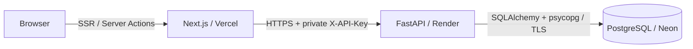

# Architecture

The parent Git repository owns Compose, documentation and developer hooks; the
frontend/backend are independently deployable submodules. Original design tokens
in `globals.css` and the shadcn preset in `components.json` are preserved.

Locally the same layers run inside Compose, with PostgreSQL in a persistent named
volume. No database or backend host port is published.

## Boundaries

Frontend `features/leads/server` owns reads/actions. `lib/server` is marked
`server-only`; validated actions return data and safe messages, never credentials.
OpenAPI-generated types describe API responses. Client components own interaction
state and receive initial data from a dynamic Server Component under Suspense.
Filters operate on the fetched list; the API also supports status/name queries.
Minute/focus refreshes use React transitions and preserve modal/form state.

Backend domain routers validate Pydantic payloads; services own commits;
repositories own queries. Latest-discussion selection uses a window query, avoiding
one query per lead. Row locks serialize writes per lead. Saving a note and updating
its follow-up share a transaction. Errors roll back and use redacted messages.
Alembic owns schema changes, never runtime `create_all`.

## Calendar rules

Dates persist as PostgreSQL timezone-aware instants. `APP_TIMEZONE` supplies the
calendar zone. Today's group compares local calendar dates; overdue compares the
scheduled instant with the server clock. They can overlap without duplication.
Today's leads sort by due time, then overdue leads, then recent discussions.
Local datetime input is converted with Temporal and rejects ambiguous/nonexistent
DST wall times. Notes without a date preserve the current schedule.

## Readability

Hand-written files have one responsibility and are generally below 200 lines.
Shared UI primitives contain no API logic. Generated API types are intentionally
larger. Domain tests cover real PostgreSQL transactions and date boundaries;
frontend unit tests cover conversion/DST rules. See verification for runtime flows.
