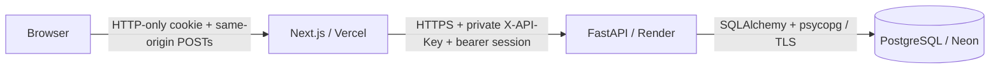

# Architecture

The parent Git repository owns Compose, documentation and developer hooks; the
frontend/backend are independently deployable submodules. Original design tokens
in `globals.css` and the shadcn preset in `components.json` are preserved.

Locally the same layers run inside Compose, with PostgreSQL in a persistent named
volume. No database or backend host port is published.

## Boundaries

`/` is a static public landing page composed from `features/marketing`; its
illustration uses explicitly labeled fictional data and never reads the backend.
`/workspace` contains the authenticated server-streamed lead manager. Account
entry redirects to this route, and lead mutations revalidate it. Branding links
return to the public page. A shared SVG mark also supplies the raster favicon.

Auth pages keep their shared shell outside Suspense and reserve form geometry
with `AuthSkeleton`. The workspace reuses its header in `WorkspaceSkeleton`.
Skeletons/spinners use the installed shadcn primitives, expose loading/busy
states, and disable animation for reduced-motion preferences. Pending controls
stay disabled through completion; auth navigation retains its spinner until
the next document loads. No minimum artificial loading delay is added.

The toolbar shares one status value between compact Select and desktop
ToggleGroup presentations. CSS selects the layout at the `lg` breakpoint;
no browser-width branch or forced remount is used. Mobile rows stack, tablet
selectors sit side by side, and desktop buttons wrap instead of clipping in a
scroll strip. Lead names/company text wrap within the card on narrow screens.

Frontend `features/leads/server` owns reads/actions. `lib/server` is marked
`server-only`; validated actions return data and safe messages, never credentials.
OpenAPI-generated types describe API responses. Client components own interaction
state and receive initial data from a dynamic Server Component under Suspense.
Filters operate on the fetched list; the API also supports status/name queries.
Minute/focus refreshes use React transitions and preserve modal/form state.

Backend domain routers validate Pydantic payloads; services own commits;
repositories own queries. Latest-discussion selection uses a window query, avoiding
one query per lead. Row locks serialize writes per lead. Saving a note and updating
its follow-up share a transaction. Errors roll back and use redacted messages.
Alembic owns schema changes, never runtime `create_all`.

## Authentication and ownership

`backend/auth` owns Argon2id password verification, opaque session issuance,
expiry/revocation, database-backed login/registration counters and private CLI provisioning.
`auth/repository.py` shares account insertion between registration and the CLI.
Registration commits its account and first session together; only the CLI can
claim legacy leads. New users start empty and optional seeding remains explicit.
Only token digests persist in PostgreSQL. Next.js stores the bearer token in an
HTTP-only cookie and forwards it from its server boundary; it never serializes
the token into page props, action results or authentication JSON responses.
Registration, login and logout use Route Handlers so password values never enter Server Action
argument diagnostics. Every domain request resolves a live, active user; all lead
queries include that user’s ID and discussion access checks the parent’s ownership.
No user-specific server caching is used. Account entry/logout hard navigation clears
client/router state between accounts. See [authentication](authentication.md).

## Calendar rules

Dates persist as PostgreSQL timezone-aware instants. `APP_TIMEZONE` supplies the
calendar zone. Today's group compares local calendar dates; overdue compares the
scheduled instant with the server clock. They can overlap without duplication.
Today's leads sort by due time, then overdue leads, then recent discussions.
Local datetime input is converted with Temporal and rejects ambiguous/nonexistent
DST wall times. Notes without a date preserve the current schedule.
The shadcn Calendar/Popover date picker uses `TZDate` and the app timezone,
independently of the browser timezone. `TimePicker` composes existing shadcn
Selects for hour, minute and AM/PM; it uses no native `type="time"` control.
`lib/time-input.ts` handles 12/24-hour conversion and retains partial selections.
The parent combines date and time; server validation rejects incomplete selections
before UTC conversion. Display state follows the controlled value, so successful
saves reset every segment without effects or forced remounts.

## Public discovery

`lib/site-metadata.ts` shares environment-derived URLs across canonical tags,
Open Graph/Twitter cards, JSON-LD, robots and sitemap. Only the public homepage
opts into indexing. The thumbnail is the owner's supplied dark landing PNG;
private session/lead data never enters metadata. See [SEO](seo.md).

## Readability

Hand-written files have one responsibility and are generally below 200 lines.
Shared UI primitives contain no API logic. Generated API types are intentionally
larger. Domain tests cover real PostgreSQL transactions and date boundaries;
frontend unit tests cover conversion/DST rules. Auth pages share a server-rendered
shell and a focused client form with schema validation and password confirmation. See verification for runtime flows.
